<div align="center">

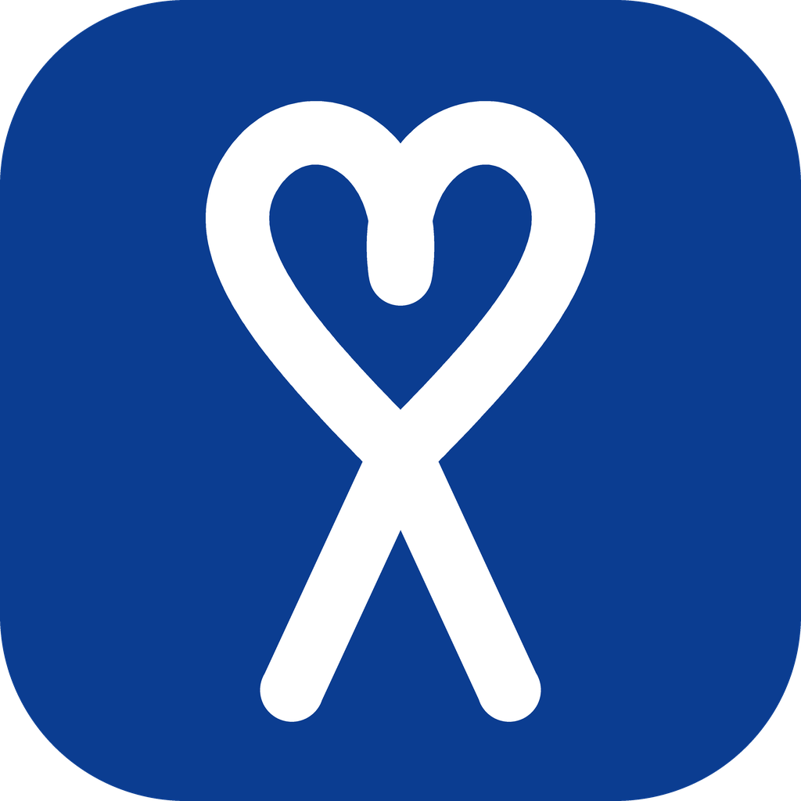

# Lazo

**Un acompañante para las medicinas, las citas y el bienestar de personas con discapacidad visual, motriz o en el espectro autista, y para quienes las cuidan.**

Gratuito · Código abierto · Accesible desde su diseño


### [▶ Pruébalo en tu navegador: lazoapp.vercel.app](https://lazoapp.vercel.app)

<sub>La app real con los datos de Mateo (ficticios): háblale, márcale una toma, revisa sus citas. Incluye el video de presentación.</sub>

<sub>Proyecto presentado al <i>Premio Estatal por la Discapacidad «Manuel Trueva Martínez 2026»</i> (Chihuahua).<br>Todas las demostraciones usan <b>personas y datos ficticios</b>.</sub>

</div>

---

## Así se ve

<table>
  <tr>
    <td align="center" width="25%">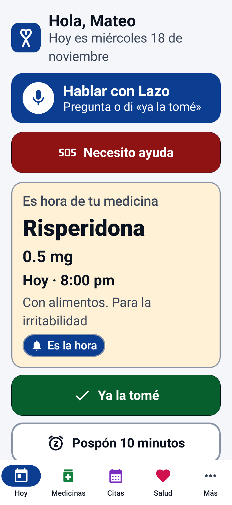<br><sub><b>Hoy</b><br>La toma que toca, leída en voz alta</sub></td>
    <td align="center" width="25%">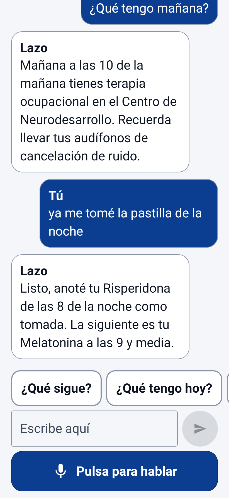<br><sub><b>Hablar con Lazo</b><br>Por voz o por escrito</sub></td>
    <td align="center" width="25%">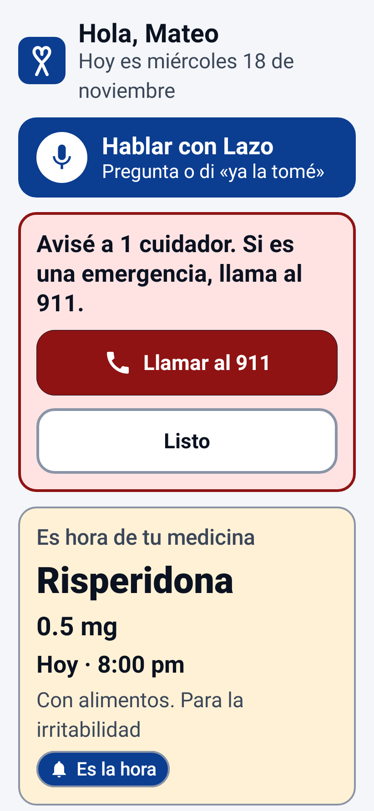<br><sub><b>Necesito ayuda</b><br>Avisa al círculo y ofrece el 911</sub></td>
    <td align="center" width="25%">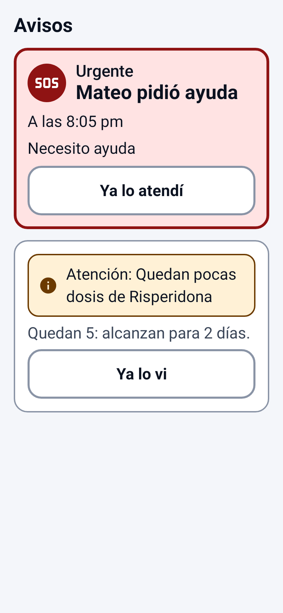<br><sub><b>Cuidador</b><br>El aviso urgente, primero</sub></td>
  </tr>
  <tr>
    <td align="center">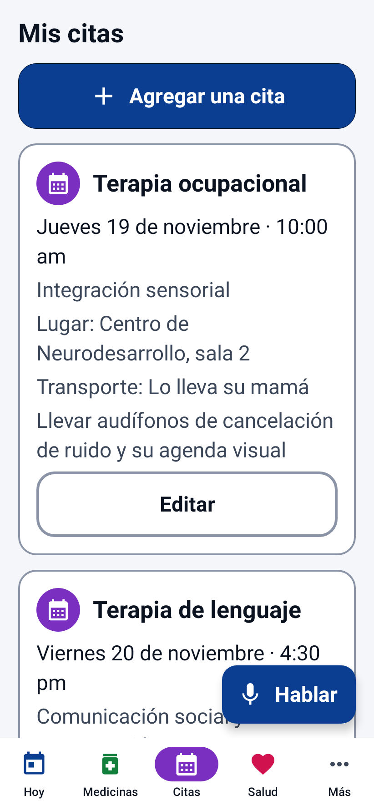<br><sub><b>Citas</b><br>Recordatorio la víspera y 2 h antes</sub></td>
    <td align="center">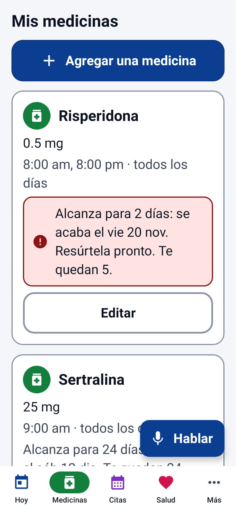<br><sub><b>Medicinas</b><br>Para cuántos días alcanza</sub></td>
    <td align="center">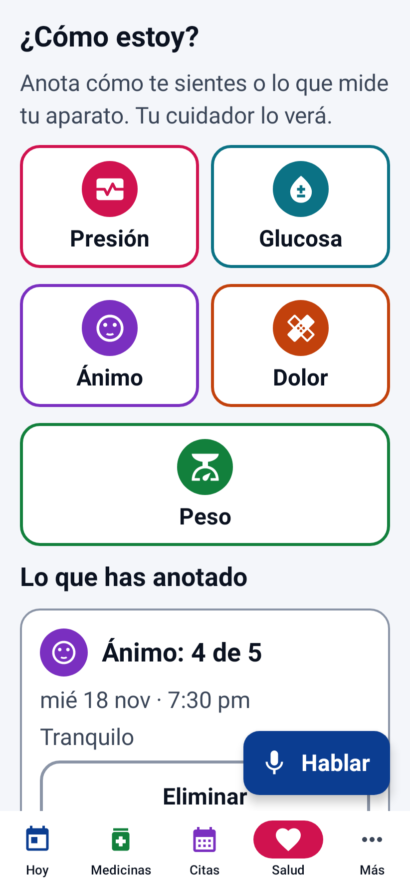<br><sub><b>Cómo estoy</b><br>Presión, glucosa, ánimo, dolor y peso</sub></td>
    <td align="center">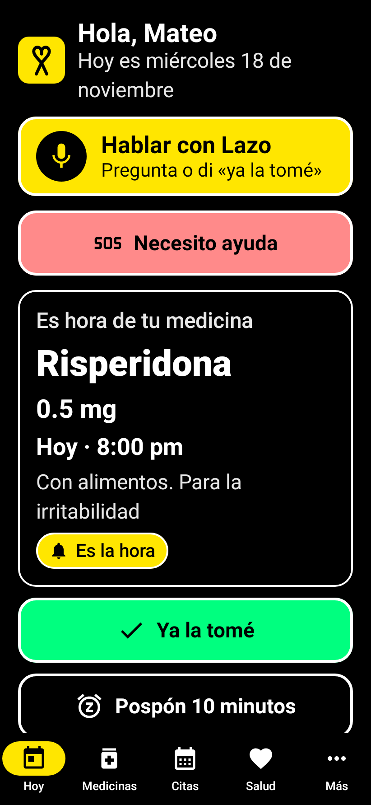<br><sub><b>Alto contraste</b><br>Amarillo sobre negro</sub></td>
  </tr>
</table>

<div align="center">
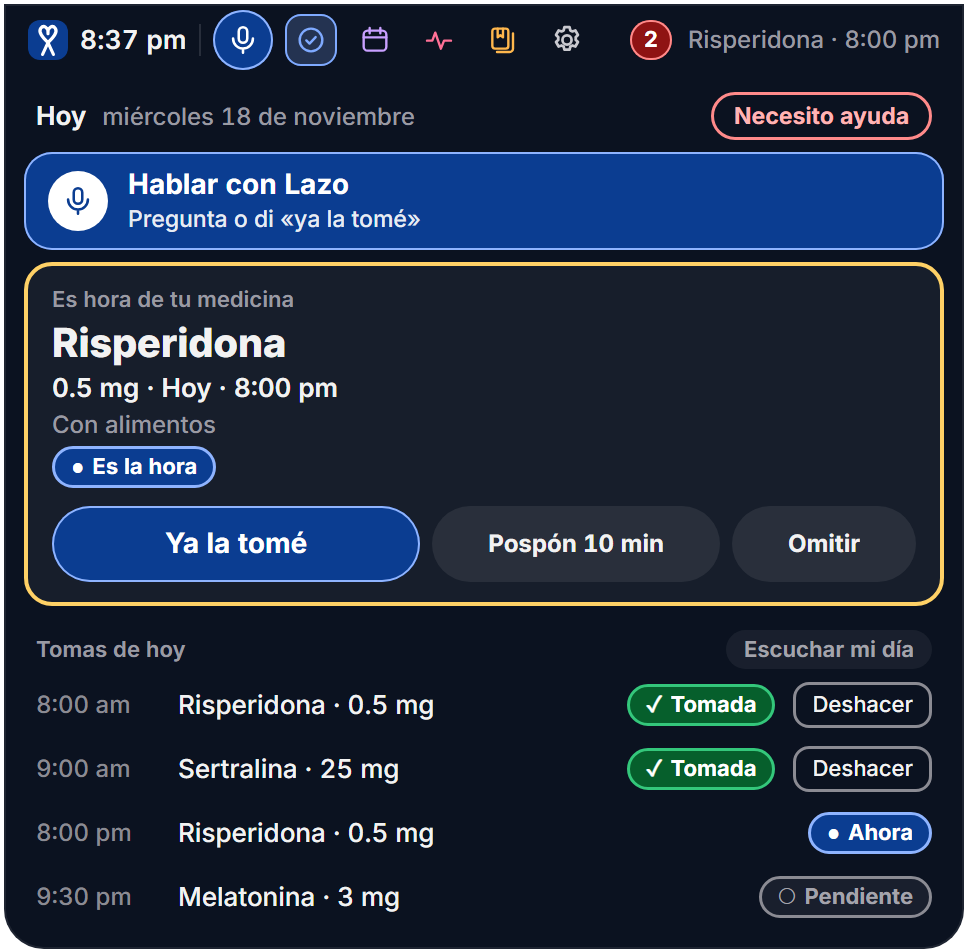<br>
<sub><b>Asistente de Windows 11</b>: una barra en la parte superior de la pantalla con el mismo día que el teléfono, dictado por voz local y avisos.</sub>
</div>

> La persona de las capturas es ficticia: **Mateo**, un joven autista que toma risperidona (por eso vigila su peso y su glucosa) y lleva terapia ocupacional y de lenguaje.

---

## Qué hace

| | Función | Cómo ayuda |
|:-:|---|---|
| 💊 | **Medicinas** | Alarmas exactas **sin internet** que se **leen en voz alta**; se confirman con un toque grande o con la voz («ya la tomé», «pospón diez minutos»). Indica para cuántos días alcanza cada una. |
| 🎙️ | **Hablar con Lazo** | Chat con audio o texto, en lenguaje natural («ya desayuné y me tomé la del azúcar», «agéndame cita con el oculista el viernes»). Nunca diagnostica ni cambia dosis. |
| 🆘 | **Necesito ayuda** | Un botón con confirmación, o la frase «necesito ayuda / auxilio», avisa de inmediato al círculo de cuidado y ofrece llamar al 911. |
| 📅 | **Citas** | Agenda con lugar, transporte y notas; recordatorios la víspera y 2 horas antes, en el teléfono y en Windows. |
| ❤️ | **Cómo estoy** | Presión, glucosa, ánimo, dolor y peso, con avisos **orientativos** (nunca un diagnóstico). |
| 👪 | **Círculo de cuidado** | El cuidador se une con un código de 6 dígitos y ve, **solo en lectura**, las tomas, las dosis sin confirmar, las citas y los pedidos de ayuda. |
| 📢 | **Apoyos** | Las convocatorias de la Secretaría de Desarrollo Humano y Bien Común de Chihuahua, con las de discapacidad primero y su enlace oficial. Lazo **no inventa fechas**. |
| 🔗 | **Varios dispositivos** | El teléfono y la computadora de la misma persona se vinculan con un código y se mantienen sincronizados. |

## Accesibilidad, desde el diseño

<table>
  <tr>
    <td width="33%" valign="top"><b>👁️ Visual</b><br>Contraste ≥ 7:1, letra hasta el doble, alto contraste amarillo sobre negro, lectura en voz alta y TalkBack en cada elemento.</td>
    <td width="33%" valign="top"><b>✋ Motriz</b><br>Áreas táctiles ≥ 64 dp, una acción principal por pantalla, órdenes por voz y acciones de TalkBack o de interruptor en cada toma.</td>
    <td width="33%" valign="top"><b>🧩 Espectro autista</b><br>Avisos con anticipación, notas para cada cita, comunicación por escrito con frases sugeridas y una interfaz tranquila, sin animaciones.</td>
  </tr>
</table>

Ningún estado se comunica solo con color: siempre lleva texto y un signo. Detalle y pruebas en [`docs/ACCESIBILIDAD.md`](docs/ACCESIBILIDAD.md).

## Tres piezas

| Carpeta | Qué es | Tecnología |
|---|---|---|
| [`server/`](server/README.md) | Servidor: guarda los datos, calcula los avisos, conversa y lee las convocatorias | Node.js 20+, **sin dependencias** |
| [`android/`](android/README.md) | App del teléfono (persona y cuidador) | Kotlin + Jetpack Compose |
| [`desktop/`](desktop/README.md) | Asistente de Windows 11: barra superior con dictado y órdenes por voz locales | Tauri 2 (Rust + React) |

## Empezar en cinco minutos

```bash
cd server && npm test && LAZO_HOST=0.0.0.0 node scripts/demo.js   # servidor con datos ficticios
```

Luego instala el APK (`android/app/build/outputs/apk/release/`) y abre Lazo. Guía completa: [`docs/entrega/preparar-demo.md`](docs/entrega/preparar-demo.md).

## Privacidad

Sin cuentas ni analítica. Terceros, solo cuando hablas o escribes una frase libre a Lazo: el audio va a Whisper (Groq) solo para convertirlo en texto, y la frase —con lo mínimo de tu agenda y tus medicinas que haga falta para responder— va a Claude (Anthropic); nada se guarda en esos servicios por parte de Lazo. Las frases cortas como «qué sigue» o «ya la tomé» se resuelven en el propio servidor, sin terceros. Quien no quiera usarlo puede escribir sus órdenes o tocar las frases sugeridas, y el dictado de Windows es 100 % local. Cada persona tiene su propio espacio aislado dentro del servidor (nadie ve ni toca los datos de otra), con el archivo de datos en modo privado y los tokens guardados solo como huella. Quien quiera tener el suyo —un municipio, una asociación— lo monta con un comando y la app admite cambiar de servidor en «Opciones avanzadas». El dictado y las órdenes por voz de Windows se procesan en la computadora. Lo único que se descarga de internet es la página pública de convocatorias.

## Pruebas

| Pieza | Pruebas | Incluye |
|---|:-:|---|
| Servidor | **111** | Aislamiento entre hogares, conversación con el modelo, «Necesito ayuda», resurtir, casos de medianoche |
| Android | **89** | Pantallas con capturas, contraste de la paleta, prueba contra el servidor real |
| Windows | **168 + 84** | Interfaz (TypeScript) y Rust (45 de la app y 39 del núcleo) |

## Licencia

MIT. Ver [`LICENSE`](LICENSE) y [`desktop/THIRD_PARTY.md`](desktop/THIRD_PARTY.md).

<div align="center"><br>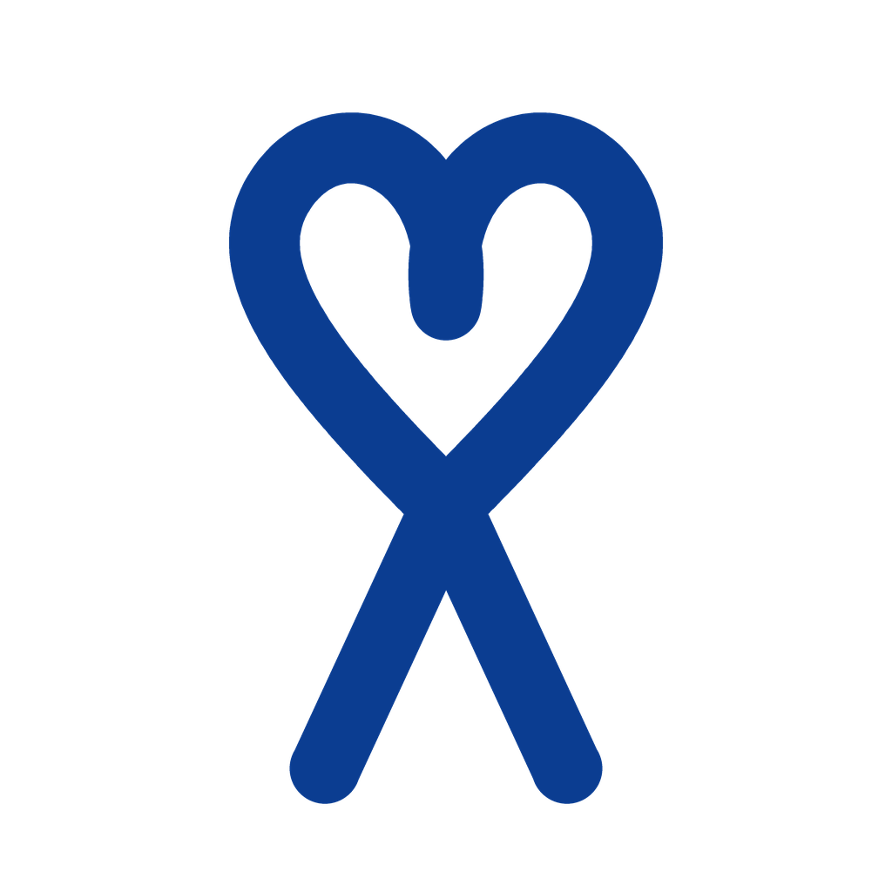<br><sub>Hecho en Chihuahua para que nadie se quede fuera del cuidado de su salud.</sub></div>

---

## Demo web

`web/` publica en [lazoapp.vercel.app](https://lazoapp.vercel.app) la isla de Windows funcionando en el navegador, junto con el video y la presentación del proyecto.

- **La interfaz** son los mismos paneles de `desktop/src`; las llamadas a Tauri se cambian por pequeños *shims* del navegador (`web/src/shims`).
- **El servidor** es el mismo `server/src`, copiado dentro de una función de Vercel (`web/api/lazo.js`) que lo arranca en memoria en cada petición.
- **Los datos** de Mateo viven en el navegador de cada visitante (`localStorage`) y viajan en cada petición: no hay base de datos ni datos de nadie más. Se vuelven a sembrar cada día.
- **El chat y la voz** usan Claude y Whisper (Groq), con topes por visitante; si se pasan, contesta el intérprete de frases.

```bash
cd web && npm install
npm run armar                    # copia el servidor, compila y deja todo en web/.salida
node scripts/servir.mjs          # prueba local en http://localhost:4747
npm run publicar                 # sube .salida a Vercel (proyecto «lazo»)
```

